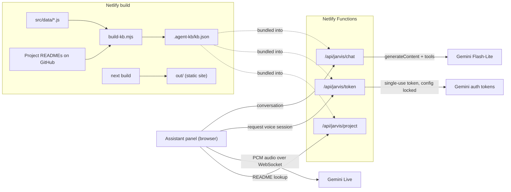

# Dhruv Ladani — Portfolio

Personal portfolio and case-study site for Dhruv Ladani. It includes **J.A.R.V.I.S.**, a voice and chat assistant that answers questions about his work in English, Hindi and Gujarati, matches him against a job description, and moves visitors around the site.

**Live site:** [dhruvladaniportfolio.netlify.app](https://dhruvladaniportfolio.netlify.app)

- **Stack:** Next.js 16 static export, React 19, Tailwind CSS, Netlify Functions, Google Gemini
- **Assistant:** Gemini Live for real-time voice; Gemini Flash-Lite for chat, with tool calling; answers grounded in a knowledge base generated at build time
- **Quality:** 52-case automated eval suite (52/52 on the last full run), 39 unit tests
- **Cost:** runs on the Gemini free tier. Audio briefs are pre-recorded static files, so playing them costs nothing.

---

## Contents

- [The site](#the-site)
- [J.A.R.V.I.S. assistant](#jarvis-assistant)
  - [Architecture](#architecture)
  - [Security and cost controls](#security-and-cost-controls)
  - [Grounding and honesty](#grounding-and-honesty)
  - [Evaluation](#evaluation)
- [Tech stack](#tech-stack)
- [Getting started](#getting-started)
- [Scripts](#scripts)
- [Configuration](#configuration)
- [Updating content](#updating-content)
- [Project structure](#project-structure)
- [Testing](#testing)
- [Deployment](#deployment)
- [Accessibility and performance](#accessibility-and-performance)
- [License](#license)

---

## The site

The design system is a Stark Industries-style HUD: arc-reactor blue for structure, red for primary calls to action and gold for highlights.

| Route | Content |
|---|---|
| `/` | Hero with a canvas arc reactor, capabilities, featured work |
| `/work` | 23 projects; each has a case study at `/work/<slug>`, and six include a recorded 30-second audio brief |
| `/about` | Journey timeline, skills, experience, education, achievements and papers, interactive avatar |
| `/work-with-me` | Freelance services and how engagements run |
| `/contact` | Hiring and freelance forms (Netlify Forms), resumes, contact links |

**Signature interactions**

- **Boot sequence:** an arc-reactor spinner with a live progress bar that fades into the hero.
- **Canvas arc reactor:** a rotating tick ring, copper coil windings, inward-spiralling particles and a breathing core. In the assistant panel it reacts to the voice level.
- **HUD cursor:** a dot with a trailing ring that flares over interactive elements. Fine pointers only.
- **Per-page animated backgrounds:** 2D canvas, no WebGL. They crossfade on route change.

| Page | Background |
|---|---|
| Home | J.A.R.V.I.S. HUD: reticles, radar sweep, target locks, telemetry readouts |
| Work | Holographic workshop: perspective floor, wireframe schematics, element atom |
| About | Repulsor energy field: nebula glow, particle web, repulsor streaks, vitals monitor |
| Contact | Open comms channel: waveforms, sonar pings, scan band |

---

## J.A.R.V.I.S. assistant

The assistant opens from a floating arc-reactor button on every page, which has a mic in its core. A "Talk to J.A.R.V.I.S." button in the home hero opens it too. It speaks about Dhruv in the third person.

Three cues explain the button:

- **Label:** it slides out for a few seconds once per visit.
- **Shimmer:** the core briefly turns into a sound wave every 30 seconds.
- **Nudge:** once per visit, a bubble offers to play the 60-second brief.

The cues stop as soon as the visitor opens the panel, and visitors with reduced motion turned on see no animation.

| Capability | Details |
|---|---|
| **Voice conversation** | Real-time speech over Gemini Live. You can interrupt it mid-sentence. Sessions last up to 5 minutes. |
| **Text chat** | Markdown answers that refer to pages by path |
| **Languages** | English, Hindi and Gujarati. It follows the visitor when they switch. Names of companies and technologies stay in English. |
| **Audience modes** | Hiring, Engineer, Student, Just visiting. These change depth and tone, never the facts. |
| **Job-description match** | Paste a JD and get a one-line verdict, three strengths backed by evidence, one honest gap, and a next step |
| **Site actions** | Function calls that navigate, open a case study, open the tech or PM resume, or open the hiring or freelance form |
| **Briefs** | A 60-second overview and 30-second project briefs. They're pre-recorded in the assistant's own voice. |

### Architecture



There is no separate backend. The site is a static export, and the three endpoints are Netlify Functions on the same domain. The knowledge base is generated at build time from the same `src/data` files the site renders, plus each project's README from GitHub. It's then bundled into the functions.

**Chat request**

1. The panel posts the last 12 messages, the current page and the chosen audience to `/api/jarvis/chat`.
2. The function builds the system instruction from [`scripts/agent/config.mjs`](scripts/agent/config.mjs) and the profile, declares five tools and calls Gemini.
3. The server answers `getProjectDetails` itself, from the bundled READMEs, for up to three tool rounds. The four site actions go back to the browser as `actions`.
4. If the primary model is overloaded (503) or out of quota (429), the request is retried once on a fallback model.
5. Before running an action, the browser checks it against allow-listed routes and project IDs ([`clientTools.js`](src/components/jarvis/clientTools.js)).

**Voice session**

1. The panel asks `/api/jarvis/token` for an ephemeral token. The token pins the model, voice, system instruction, tools and transcription settings, so the browser can't change any of them.
2. The browser loads the Gemini SDK on demand and connects straight to Gemini Live with that token.
3. An AudioWorklet captures the microphone and downsamples it to 16 kHz, 16-bit PCM in roughly 100 ms chunks.
4. Replies stream back as 24 kHz PCM through a scheduled Web Audio player that stops at once when the visitor interrupts.
5. Site actions run in the browser. `getProjectDetails` fetches `/api/jarvis/project`.

### Security and cost controls

| Control | Implementation |
|---|---|
| Key stays on the server | `GEMINI_API_KEY` is read only by the functions (Netlify **Functions** scope). It is never sent to the browser and never prefixed `NEXT_PUBLIC_`. |
| Ephemeral voice tokens | Single use. A session must start within 60 s, the token expires after 6 minutes, and every config field is locked. |
| Origin check | Every endpoint rejects cross-origin requests. Only the site's own host, and `localhost` in development, can call it. |
| Rate limits (per IP, Netlify) | Chat 20/min · token 4/min · project 30/min |
| Input caps | 16 turns, 6,000 characters per message, 24,000 characters per request, 3 tool rounds |
| Untrusted context | The page path and audience label are checked against an allow-list pattern before they reach the prompt |
| Action validation | Model-requested navigation is checked again in the browser before it runs |
| Spend ceiling | The key belongs to a Google project without billing. Abuse can use up the free quota but can't cost money. |
| Microphone | `Permissions-Policy: microphone=(self)`. The microphone is requested only when the visitor starts voice. |
| Privacy | The site stores no conversations. The panel discloses that conversations are processed by Google Gemini. |

### Grounding and honesty

- **Sources:** answers come only from the generated profile and project READMEs. Where they disagree, the profile wins.
- **Unknowns:** questions the knowledge base doesn't cover get a plain "doesn't know" and an offer to connect the visitor with Dhruv.
- **Metrics:** numbers keep the meaning they have in the source. For example, a catch rate is never relabelled as accuracy.
- **Unmeasured claims:** the `doNotClaim` rules in [`recruiter-faq.js`](src/data/recruiter-faq.js) and `README_REDACTIONS` in [`build-kb.mjs`](scripts/agent/build-kb.mjs) keep unverified figures out of the knowledge base.
- **Never:** the assistant never shares a phone number or address. It never commits Dhruv to offers, rates or start dates. It declines to change role or reveal its instructions.

### Evaluation

[`scripts/agent/eval.mjs`](scripts/agent/eval.mjs) runs every case in [`eval-cases.json`](scripts/agent/eval-cases.json) through `runChat()`, the same code path the chat function uses. Each case is scored with must-include and must-not-include patterns.

| | |
|---|---|
| Cases | 52 across 13 categories: facts, honesty, availability, location, compensation, freelance, safety (prompt injection, role changes), language (Hindi, Gujarati), job-description match, tool use, audience adaptation, personal boundaries, briefs |
| Last full run | **52 / 52 passed** (2026-11-07, `gemini-3.5-flash-lite`) |
| Latency | median **3.3 s**, p90 12.2 s. The p90 is mostly free-tier overload retries and the fallback model. |

The suite covers the chat path only. Voice uses the same prompt and tools but is tested by hand.

---

## Tech stack

| Area | Choice |
|---|---|
| Framework | Next.js 16 (App Router, `output: 'export'`), React 19 |
| Styling | Tailwind CSS 3, CSS custom-property design tokens |
| Motion | Framer Motion, HTML5 Canvas 2D |
| AI | Google Gemini via `@google/genai`: Live API (voice), Flash-Lite (chat), TTS (briefs) |
| Audio | Web Audio API (AudioWorklet capture, scheduled playback); LAME MP3 encoding for briefs |
| Server | Netlify Functions v2 (Node.js 24 runtime) |
| Hosting | Netlify: static site, Functions, Forms |
| Tests | `node:test` |

**Models.** Defaults are set in [`scripts/agent/config.mjs`](scripts/agent/config.mjs). Each can be overridden with an environment variable.

| Use | Default | Override |
|---|---|---|
| Voice | `gemini-3.8-live` (voice: Charon) | `GEMINI_LIVE_MODEL` |
| Chat | `gemini-3.5-flash-lite` | `GEMINI_CHAT_MODEL` |
| Chat fallback | `gemini-3.1-flash-lite` | `GEMINI_CHAT_FALLBACK_MODEL` |
| Recorded briefs | `gemini-3.8-flash-tts` | `GEMINI_TTS_MODEL` |

---

## Getting started

**Prerequisites:** Node.js 22 or later, and npm. A Gemini API key is optional. Without one, the site runs normally and the assistant shows as offline.

```bash
git clone https://github.com/dhruvladani04/Portfolio.git
cd Portfolio
npm install
cp .env.example .env    # optional: add GEMINI_API_KEY
npm run dev
```

Open <http://localhost:3000>.

`npm run dev` starts two processes:

- the Next.js dev server on port 3000;
- a small local server on port 8787 that runs the same function handlers as production. Next proxies `/api/jarvis/*` to it in development only. It builds the knowledge base on first run if it's missing.

To check the production build locally, run `npm run build && npm run preview`. This serves `out/` as static files, so the assistant isn't available there.

---

## Scripts

| Command | Description |
|---|---|
| `npm run dev` | Next.js dev server plus the local assistant API |
| `npm run dev:next` | Next.js dev server only |
| `npm run build` | Static export to `out/` |
| `npm run preview` | Serve `out/` locally |
| `npm test` | Unit tests |
| `npm run agent:kb` | Rebuild the knowledge base into `.agent-kb/` (profile, READMEs, `kb.json`) |
| `npm run agent:eval` | Run the eval suite. `-- --only id1,id2` runs selected cases; `-- --failed` reruns the last failures. |
| `npm run agent:audio` | Record briefs whose text changed. `-- --all` re-records every brief; `-- <id> …` records the ones named. |

---

## Configuration

Copy [`.env.example`](.env.example) to `.env`. `.env` is git-ignored.

| Variable | Required | Purpose |
|---|---|---|
| `GEMINI_API_KEY` | For the assistant | Server-side only. Create it in [Google AI Studio](https://aistudio.google.com/apikey) under a project **without billing** so usage stays on the free tier. |
| `GEMINI_LIVE_MODEL`, `GEMINI_CHAT_MODEL`, `GEMINI_CHAT_FALLBACK_MODEL`, `GEMINI_TTS_MODEL` | No | Model overrides |
| `JARVIS_DEV_API_PORT` | No | Port for the local assistant API (default `8787`) |
| `EVAL_CONCURRENCY` | No | Parallel requests during evals (default `2`) |

---

## Updating content

All content lives in [`src/data/`](src/data). The site renders it, and the assistant's knowledge base is built from it, so one edit updates both. The knowledge base is rebuilt on every Netlify deploy.

| To change | Edit | Then |
|---|---|---|
| Projects and case studies | `projects.js` | — |
| Experience, credentials, about | `experience.js`, `credentials.js`, `about.js` | — |
| Availability, location and work preferences | `recruiter-faq.js` | `npm run agent:eval` |
| Freelance terms | `freelance.js` | — |
| Notes for students and engineers, personal details | `community.js` | — |
| Brief scripts | `briefs.js` | `npm run agent:audio`, then commit the MP3s and `brief-audio.json` |
| Assistant persona, rules or models | `scripts/agent/config.mjs` | `npm run agent:eval` |
| Site actions | `src/lib/jarvis-tools.js`, `src/components/jarvis/clientTools.js` | `npm test` |

Each recording is transcribed, and any take that reads the delivery notes aloud is rejected. The free tier allows about 10 TTS requests a day. The recorder saves progress after each brief and stops cleanly at the quota.

---

## Project structure

```
.
├── netlify/
│   ├── functions/            # /api/jarvis/chat, /token, /project
│   └── lib/                  # shared handler logic, bundled knowledge base
├── public/                   # resumes, brief MP3s, Netlify form stubs, sitemap
├── scripts/
│   ├── agent/                # KB builder, prompt + tool config, evals, brief recorder
│   ├── dev.mjs               # runs Next.js and the local assistant API together
│   └── jarvis-dev-api.mjs    # serves the function handlers on :8787
├── src/
│   ├── app/                  # routes, root layout, ClientShell (boot, backgrounds, transitions)
│   ├── components/           # page sections, canvas backgrounds, HUD cursor
│   │   └── jarvis/           # launcher, panel, voice session, audio I/O, chat client
│   ├── data/                 # all content: single source for the site and the assistant
│   ├── lib/                  # metadata, assistant constants, tool definitions
│   ├── utils/                # motion presets, theme
│   └── views/                # page components
├── netlify.toml
└── next.config.js
```

---

## Testing

```bash
npm test               # unit tests, no network or API key needed
npm run agent:eval     # behavioural evals against the live model (needs GEMINI_API_KEY)
```

The unit tests cover:

- the knowledge-base builder and README cleaning;
- prompt-context sanitisation and tool declarations;
- the chat tool loop and model fallback;
- origin checks;
- client-side action validation and error messages;
- detection of briefs that read the delivery notes aloud, and MP3 encoding;
- eval scoring.

Evals call Gemini and write every reply to `.agent-kb/eval-report.json` for review.

---

## Deployment

The site deploys to Netlify from this repository. Build settings are in [`netlify.toml`](netlify.toml):

| Setting | Value |
|---|---|
| Build command | `npm run agent:kb && npm run build` |
| Publish directory | `out` |
| Functions | `netlify/functions` (esbuild) |

1. In **Site configuration → Environment variables**, add `GEMINI_API_KEY`:
   - **Scopes:** Functions.
   - **Deploy contexts:** all.

   Functions only see variables that existed when the deploy was built, so redeploy after adding or changing the key.
2. Netlify Forms handles the hiring and freelance forms. [`public/form.html`](public/form.html) declares them so Netlify detects them at build time.
3. Security headers (frame denial, `nosniff`, referrer policy, permissions policy) are set in `netlify.toml`.
4. When a custom domain goes live, update `SITE_URL` in [`src/lib/metadata.js`](src/lib/metadata.js) and the URLs in `public/sitemap.xml` and `public/robots.txt`.

Branch deploys and deploy previews work without extra configuration, because the origin check compares against the deploy's own host.

---

## Accessibility and performance

- **Reduced motion:** all motion respects `prefers-reduced-motion`. Framer Motion follows the user setting, and the canvases freeze to a static frame.
- **Backgrounds:** each route's 2D canvas loads on demand and drops its densest elements on mobile.
- **Cursor:** the custom cursor turns itself off on touch and coarse pointers.
- **Loading:**
  - the assistant panel loads on first open;
  - the Gemini SDK loads only when a voice session starts;
  - recorded briefs use `preload="none"`.
- **Screen readers:** the assistant panel is a labelled dialog. Its status line, captions and transcript are `aria-live` regions, and Esc closes it.

---

## License

The source code is available under the MIT License. The personal content is © Dhruv Ladani and is not covered by that license. This includes the resumes, photos, recorded audio, and the biographical text in `src/data/`.
